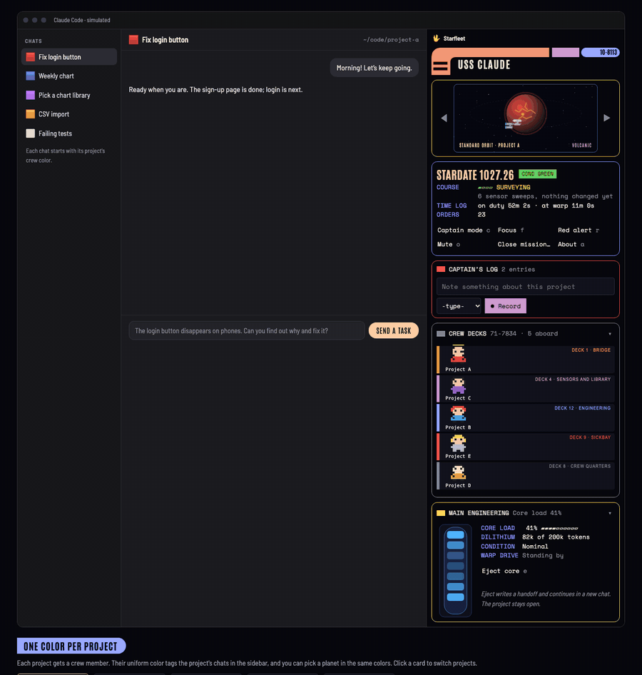

# Starfleet

Starfleet is a Claude Code mod that shows you what Claude is doing on each of your projects, warns you before a chat runs out of room, and keeps your notes in one place. It also makes Claude Code look and feel like the bridge of a starship.

<p align="center">
  <a href="https://claude.ai/artifact/EXnVvVFcAgf7jU5NGX6VpU">
    
  </a>
</p>

<p align="center">
  <a href="https://claude.ai/artifact/EXnVvVFcAgf7jU5NGX6VpU"><b>▶ Try the interactive demo</b></a><br>
  <sub>Runs in your browser with made-up projects. Nothing to install.</sub>
</p>

## Features

### A crew member for every project, with live updates

Each project gets its own 8-bit crew member, and they move around the ship as Claude works. They head to Sensors and Library while Claude reads and searches, to Engineering while it edits and runs commands, and back to the Bridge when it's waiting on you. A glance tells you where each project's work is at. Each project also gets its own planet and color, and its chats in the sidebar carry the same color tag, so you always know which project you're in.

### Captain's log

Jot notes as you go with `/log <note>` or the log box in the console: thoughts, to-dos, things to come back to. Every note lands in your own Starfleet Command page on claude.ai, so your thinking for a project stays in one place instead of scattered across chats.

### Last order

The console shows a short title for the last thing you asked Claude to do. When you're bouncing between projects, it tells you where you left off.

### Warp core: context you can see

The warp core fills as the chat's context fills, and it warns you as it climbs. When it's getting full, eject the core: Claude writes a handoff document, and a new chat reads it and picks up right where you left off. No more losing the thread to a chat that ran out of room.

### Made for visual minds

If you think in pictures, this is for you. Instead of scrolling back through chats to figure out what's going on, you can see it: who's working, what's done, how full the chat is, and what you said you'd do next.

### Also on board

- **Console** (`/starfleet`): viewscreen with a planet per project, mission briefing, warp core, crew decks and a captain's log.
- **Starfleet Command hub**: a private claude.ai page for your log, crew and mission history. Notes you Record go there on their own, the crew when you rescan, and missions when you press Close mission. The first Close mission publishes your own copy from `assets/hub.html` and remembers its link. `/hub` shows the link, `/hub <url>` points the mod at a hub you already have, and `/hub clear` forgets it.
- **Missions**: each session records its dates, models, plugins, files and screenshots, and syncs them to the hub.
- **Crew** (`/crew`): your recent projects plus cloud projects you pick from GitHub. Every folder with chats counts as crew. **− Remove project** and **+ Add project** in the console's crew section (and in `/crew`) list projects by name and ask before changing anything; you can also ask Claude. Removing only takes a folder off the crew decks, the hub roster and the sidebar emoji. Added folders always stay aboard, even ones with no chats yet (Add another folder…).
- **Shields**: catches common destructive commands before they run: forced or branch-deleting `git push`, `git reset --hard`, `git clean -f`, forced `git checkout`, `git branch -D`, forced recursive deletes, recursive deletes of `~`, `/` or `.`, and `find -delete`. It reads the command the way the shell does, so it also catches these inside `bash -c`, `$(…)`, `sudo`, `xargs` and quotes, and it ignores them when they're only text (an `echo`, a commit message, or a here-document written to a file). It is not a sandbox: it can't see inside script files, and someone set on getting past it can. For hard limits, add deny rules to your Claude Code permission settings.

Press **About** (`a`) in the console for a short guide to every part and what it connects to.

Other commands: `/bridge`, `/red-alert`, `/translator`, `/captain-mode`, `/service-record`, `/starship`, `/warp-core`.

## Privacy

- **AI summaries (on by default):** starfleet sends text to Claude Haiku, through your own Claude Code account, for two things. A prompt over 48 characters (its first 6,000 characters) is sent to get a short title for the console's "Last order". When you press Mission briefing, your recent log notes and newest handoff document are sent to write the briefing. Run `/ai-summaries off` to stop both: titles then come from the prompt's first line, and the briefing shows your notes as written. `/ai-summaries on` turns them back on.
- **Translator:** `/translator` sends the text you give it to Haiku, only when you use it.
- **Hub sync:** Record and deleting a log entry write that note straight to your own hub page through Claude Code's ArtifactData tool, with no chat turn (if that's refused, Claude is asked instead). Close mission and Rescan + sync crew ask Claude to write your crew (project names and statuses) and mission records (including project paths and the files changed) there. Nothing is synced unless you press one of them.
- **Crew scan:** to place crew on their decks, starfleet runs `git status` in your recent project folders, and `gh` for any cloud repos you pick.
- Everything else stays in Claude Code's local plugin storage on your computer.

## Install

At the prompt of a Claude Code terminal session:

```
/plugin install starfleet --marketplace lorlola07/starfleet
```

Answer `y` to add the marketplace, then pick a scope.

From a shell:

```bash
claude plugin install starfleet --marketplace lorlola07/starfleet
```
